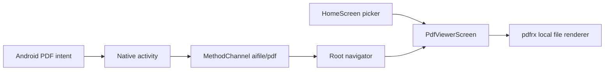

# PDF Viewer

A focused Flutter PDF reader that opens device files and integrates with Android PDF intents. The project demonstrates local file handling, native-to-Flutter communication, and customized document scrolling.

## Mobile interface preview

The intentionally minimal entry screen keeps attention on the document: tap the upload action to choose a PDF, then the selected file takes over the full viewing surface.

<p align="center">
  
</p>

## Features

- Pick a local PDF and display it with `pdfrx`.
- Open PDFs from Android “Open with” and Share actions.
- Handle cold-start and already-running intent delivery.
- Apply custom scrolling physics with a 2× speed multiplier while keeping the viewer configuration in one screen.

## Stack and architecture

Flutter / Dart (`^3.10.8`), `file_picker`, `pdfrx`, and Kotlin for Android intent handling. Dependency declarations are in [pubspec.yaml](pubspec.yaml).



`main.dart` registers `openPdf` / `pdfError` callbacks and requests `getInitialPdf` after the first frame. A navigator key lets incoming intents open the viewer without relying on a screen's context. The channel retains the name `aifile/pdf`; this is the existing native contract.

## Setup

Install Flutter with a compatible Dart SDK, Android tooling, and an emulator or device.

```sh
git clone https://github.com/Abdul-Hadi-Jalil/PDF-Viewer.git
cd PDF-Viewer
flutter doctor
flutter pub get
flutter devices
flutter run -d <device-id>
```

This application has no server or API-key setup for PDF viewing. Android intent support is platform-specific. Other generated runners require independent validation, particularly where a browser cannot provide a normal local filesystem path.

## Code map

| Path | Purpose |
| --- | --- |
| `lib/main.dart` | Bootstrap, navigation, intent channel |
| `lib/screens/home_screen.dart` | PDF picker |
| `lib/screens/pdf_viewer_screen.dart` | Renderer configuration |
| `lib/widgets/fast_pdf_scroll_physics.dart` | Scrolling customization |
| `android/app/src/main/` | Android activity and manifest |
| `test/widget_test.dart` | Existing widget checks |

## Verification

```sh
flutter analyze
flutter test
flutter build apk --debug
```

Manually verify picker cancellation, PDF rendering, scrolling, cold/hot “Open with,” Share, and unreadable files. These are verification instructions, not a claim that every platform has passed.

For startup crash investigation and device-log commands, see the [Android debugging guide](ANDROID_CRASH_DEBUGGING.md).
